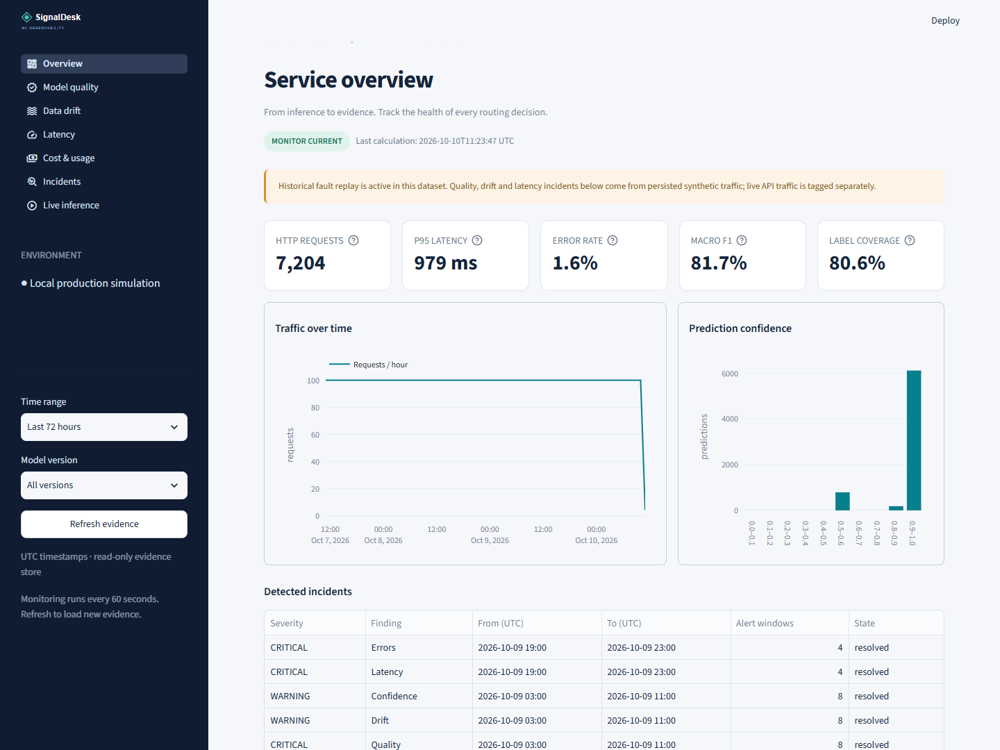
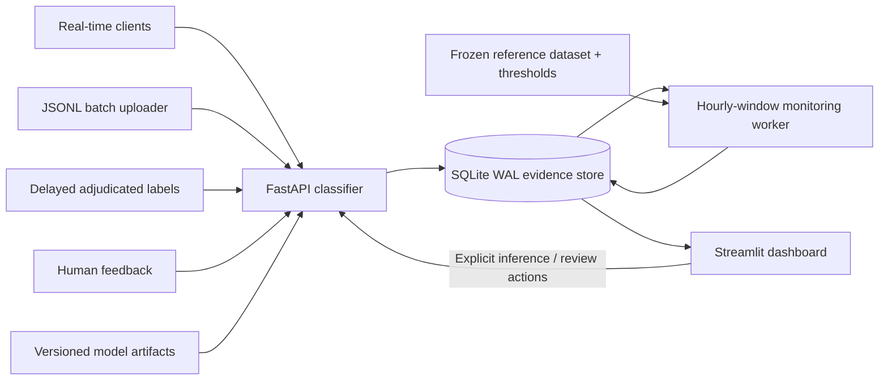
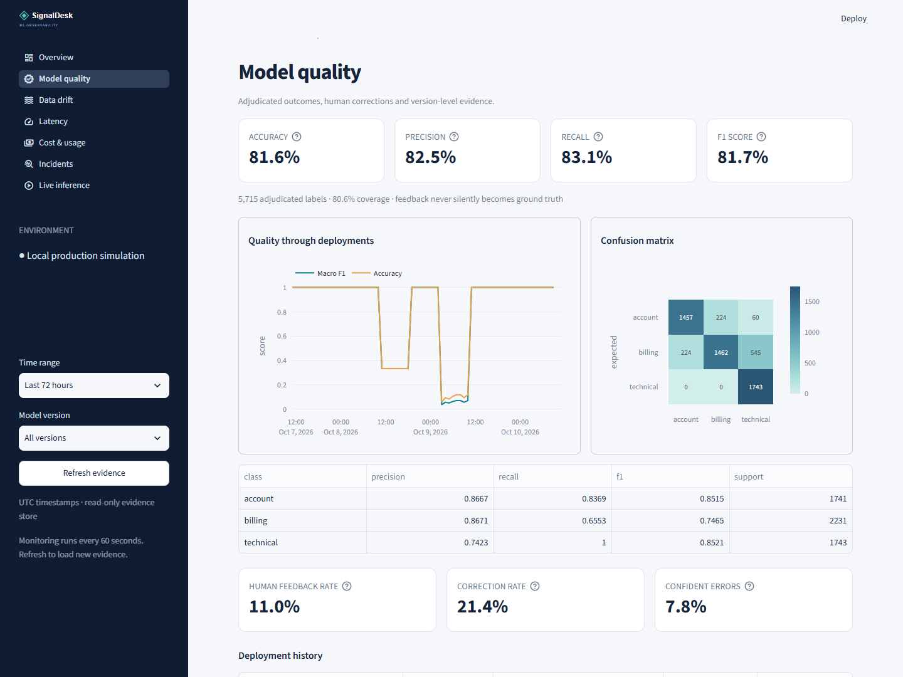
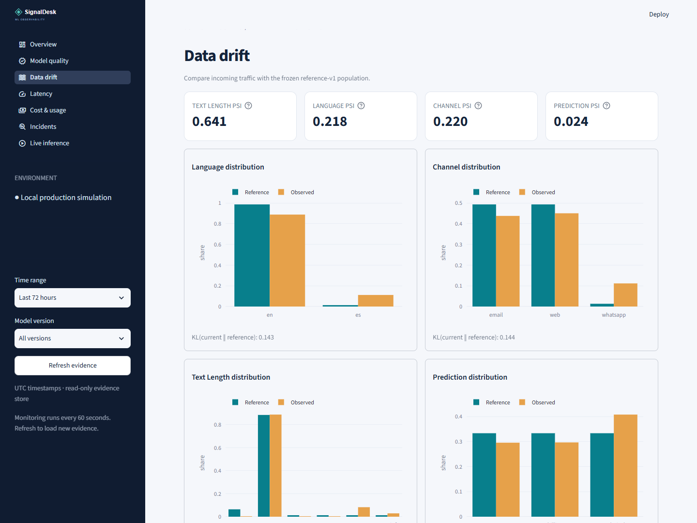
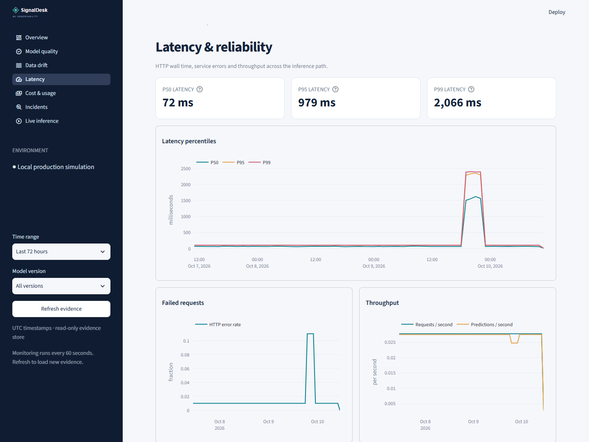

# ◈ SignalDesk

**An end-to-end ML observability workspace for a support-ticket routing service.**

FastAPI serves a trained TF-IDF + logistic-regression classifier. SQLite stores request evidence,
predictions, delayed labels, reviews and deployments. A separate monitoring worker computes hourly
quality, drift and reliability metrics, persists alerts, and powers a seven-page Streamlit dashboard.
All inference and monitoring run locally. No paid service or API credentials are required.



## Start with Docker

Requirements: Docker Engine with Compose v2. The first run trains the models and replays 72 hours of
fault-injected traffic. Initialization is idempotent; restarting retains the same evidence.

```sh
docker compose up --build -d
docker compose logs -f init monitor
```

- Dashboard: **http://localhost:8501**
- API / OpenAPI explorer: **http://localhost:8000/docs**
- Readiness: **http://localhost:8000/readyz**

The API, monitor and dashboard start after the initialization container succeeds. Named volumes
retain the database and versioned artifacts. `docker compose down` stops services without deleting
those volumes. Ports bind to loopback. See [operations](docs/operations.md) for deployment and backups.

## Start with Python

Requirements: Python 3.12 and [uv](https://docs.astral.sh/uv/). Run commands from the repository root.
Dependencies are pinned across platforms in `uv.lock`.

```sh
uv sync --frozen --python 3.12
uv run python -m signaldesk.cli bootstrap
```

Then use three terminals:

```sh
# Terminal 1: synchronous real-time and bounded batch inference
uv run uvicorn signaldesk.api:app --host 127.0.0.1 --port 8000

# Terminal 2: periodic aggregation and alerts
uv run python -m signaldesk.cli worker

# Terminal 3: dashboard
uv run streamlit run dashboard/app.py --server.address 127.0.0.1
```

You can also use `.venv/Scripts/python.exe` on Windows or `.venv/bin/python` on Linux instead of
`uv run python`. To perform one monitoring pass: `uv run python -m signaldesk.cli monitor`.

For **clean traffic without seeded failures**, point `DATABASE_PATH` and `MODEL_DIR` at fresh
directories, then run `uv run python -m signaldesk.cli train` instead of bootstrap. The model registry
includes the bad artifact for experiment reproducibility, but the clean deployment selects `router-v1`.
With Compose, set `SEED_DEMO=false` before the first run of a fresh Compose project.

## Try the complete feedback loop

Open **Live inference** in the dashboard, classify a ticket, and submit either a human review or
adjudicated ground truth. Refresh evidence after the next monitoring run. The quality page will
incorporate an adjudicated label; the feedback counters will incorporate a review. They are independent.

Using curl (use `curl.exe` on Windows PowerShell):

```sh
curl -X POST http://localhost:8000/v1/predict \
  -H 'Content-Type: application/json' \
  -d '{"text":"Please refund the duplicate payment on my invoice","channel":"email"}'

curl -X POST http://localhost:8000/v1/batch \
  -H 'Content-Type: application/json' \
  -d '{"tickets":[{"text":"The app crashes on upload"},{"text":"I cannot sign in"}]}'

# Substitute an event_id returned by either inference endpoint.
curl -X POST http://localhost:8000/v1/labels \
  -H 'Content-Type: application/json' \
  -d '{"event_id":"REPLACE","label":"billing","external_id":"crm-label-001"}'

curl -X POST http://localhost:8000/v1/feedback \
  -H 'Content-Type: application/json' \
  -d '{"event_id":"REPLACE","corrected_label":"billing","external_id":"review-001"}'
```

PowerShell example:

```powershell
$result = Invoke-RestMethod http://localhost:8000/v1/predict -Method Post `
  -ContentType 'application/json' -Body '{"text":"Please refund my duplicate payment"}'
$body = @{event_id=$result.event_id; label='billing'; external_id='crm-label-001'} | ConvertTo-Json
Invoke-RestMethod http://localhost:8000/v1/labels -Method Post -ContentType 'application/json' -Body $body
```

Submit a JSONL file through the same durable inference path:

```sh
uv run python scripts/batch.py examples/tickets.jsonl --batch-size 100
```

Batch validation is all-or-nothing; one invalid item rejects the entire request. A batch has one
HTTP request record and one prediction event per valid ticket. Batch size is capped at 1,000;
the file uploader streams arbitrarily large files in chunks. No task queue is implied by this endpoint.

See [sample HTTP requests](examples/requests.http) for labels, reviews, history and rollback examples.
`external_id` makes evidence ingestion idempotent; reuse with a different payload returns HTTP 409.
A correction to a ground-truth label uses a **new** external ID. Latest `(received_at, id)` wins.

## Architecture



The six monitoring pages read the evidence store; the workbench writes only through the API. Request
and event inserts commit together before acknowledging inference. Model selection is pinned once per
HTTP request, so a deployment cannot split a batch across versions. Pydantic validation failures and
inference errors get structured HTTP evidence too. `/healthz`, `/readyz` and management reads are
excluded from inference-volume metrics. Structured request logs go to stdout without ticket text.

SQLite WAL, foreign keys, indexes and a 30-second busy timeout support this single-host deployment.
The monitor calculates outside the writer transaction, then atomically publishes a snapshot set.
It reads facts in one consistent database snapshot and recalculates retained history to handle late
labels. At larger scale, replace full-history recomputation with dirty-window tracking and move the
event store to PostgreSQL. This implementation deliberately chooses SQLite; PostgreSQL is not bundled.

## Dashboard tour

| Page | What it answers |
|---|---|
| Overview | Are traffic, latency, errors and outcomes healthy? Is the monitor current? |
| Model quality | Which deployment changed quality? Which classes are confused? How much is labeled? |
| Data drift | Which input features shifted? Are confidence and OOV patterns unusual? |
| Latency | Did p50/p95/p99, errors or throughput change together? |
| Cost & usage | What is estimated active compute usage? Which metrics are inapplicable? |
| Incidents | What window breached a rule, and which requests and predictions support it? |
| Live inference | Can I classify a new ticket and record an independent review or label? |





The sidebar filters all pages by time range and model version. Charts are interactive. Refresh reloads
evidence; there is no implicit browser polling. Hourly chart points may include partial windows,
identified in the API snapshots. Summary cards are recalculated from raw selected events, rather than
averaging hourly percentiles or F1 values. All displayed timestamps use UTC.

## Seeded findings

Default replay: **7,200 HTTP requests, 7,088 successful predictions**, with delayed labels, human
reviews, three deployment records and a historical failed label-import run. Times are relative to
the replay start `T0`, which is 72 hours before the chosen UTC hour anchor.

| Failure | Window | Observed evidence |
|---|---|---|
| Bad model deployment | T0+24h to +32h | Macro F1 1.00 → 0.333; confident-error rate 66.7%; billing/account confusion |
| New-language traffic | T0+40h to +48h | Language PSI 9.406; long WhatsApp inputs; low-confidence rate 100% |
| Latency / availability | T0+56h to +60h | Hourly p95 2.28–2.35s vs ~106ms healthy; errors 11% vs 1% |

The model outputs come from real inference on synthetic tickets. Historic latency and failures are
injected event values, not a benchmark or a live load test. See the [incident report](docs/incidents.md)
for detection, diagnosis, recovery and verification. Default replay produces 48 aggregate alert
windows; per-version alert records are stored separately to avoid conflating models.

## Reproducibility

- `data/datasets/tickets-v1.json`: 144 labeled training examples across three classes.
- `data/datasets/reference-v1.json`: 36 frozen reference examples; exact strings differ from training,
  but templates are shared. This is demonstration evidence, not an independent generalization benchmark.
- `config/experiment.json`: RNG seed, classifier configuration and fault intervals.
- `config/alerts.json` and `config/baseline.json`: versioned monitoring and operational assumptions.
- `artifacts/models/*.joblib`: locally trained artifacts; SHA-256 registered in the database and
  checked before first load. Never load untrusted joblib files.
- Model metadata stores dataset, config and artifact hashes. Snapshot rows store the effective
  threshold hash. `prompt_version=not-applicable` explicitly records that there is no prompt.
- `uv.lock`: exact dependency versions. Docker pins Python minor version and uv version.

For exact event replay, choose fresh database/model paths and a fixed, timezone-aware anchor:

```sh
uv run python -m signaldesk.cli bootstrap --anchor 2026-10-10T12:00:00+00:00
```

Historical replay dates will eventually fall outside the dashboard's relative time range; use an
anchor near the current date for the UI demo. A repeated bootstrap preserves existing data and
original replay dates. To replay again, select fresh storage paths or a new Compose project name.
Do not edit versioned datasets in place; bump their versions when changing training inputs.

## Direct measurements, proxies and unknowns

| Signal | Measurement posture |
|---|---|
| Request volume, error rate, latency, item count | Direct live API instrumentation; seeded values are explicitly synthetic |
| Throughput | HTTP requests or predictions divided by the entire selected interval, including idle time |
| Confidence | Model probability output; **not calibrated correctness probability** |
| Accuracy, precision, recall, F1, matrix | Calculated from latest available adjudicated labels; missing labels remain unknown |
| Feedback / correction rates | Direct submitted evidence; subject to human selection bias |
| PSI and KL | Distribution-shift heuristics, using a frozen reference and smoothed histograms |
| Anomaly | Heuristic: OOV n-gram ratio >0.7 or original text length >800 |
| Likely failure category | Threshold-based diagnostic hypothesis, not causal proof |
| Freshness | Time since last successful prediction; low traffic can also make it stale |
| Compute cost | Inference wall time × assumed $0.04/hour; excludes idle/overhead/storage and is not a bill |
| LLM metrics | Tokens, LLM cost, citation failures, hallucinations and safety violations are **null/N/A**; no LLM is used |

Quality can be biased by missing labels and shares templates with the synthetic training set.
Zero-division per-class quality is 0; macro metrics always include the fixed three classes.
For details, formulas, sample gates and lifecycle semantics, see [monitoring](docs/monitoring.md).

## Verification and delivery

```sh
uv run ruff check .
uv run ruff format --check .
uv run pytest --cov=signaldesk --cov=dashboard.data --cov-report=term-missing

# With API and dashboard running:
uv run playwright install chromium
uv run python scripts/browser_smoke.py
# To use installed Chrome instead: set BROWSER_CHANNEL=chrome.
```

The tests cover metric arithmetic, missing labels, unseen drift categories, all threshold classes,
API validation/errors, real-time/batch durability, version changes, idempotent ingestion, late-label
backfills, monitor failure/recovery, seeded diagnoses and dashboard queries. Browser smoke checks
all seven pages, the inference/review loop and mobile overflow, and creates real screenshots.

[GitHub Actions](.github/workflows/ci-cd.yml) runs lint, tests, browser checks, Docker builds and
Compose smoke tests. Main-branch builds publish an immutable commit-tagged GHCR image. Deployment
uses an opt-in private Linux runner and a protected `production` environment; set `DEPLOY_ENABLED`
and `PRODUCTION_API_KEY` after provisioning it. No cloud account or target was supplied with this
project, so the workflow is provided without claiming an external deployment. Local Docker execution
requires a running engine. See [verification notes](docs/verification.md) for checks actually run.

## Project map

```text
signaldesk/     API, model training, SQLite schema, queries, metrics, alerts, worker, fault replay
dashboard/      Streamlit pages and tested data queries
data/datasets/  Versioned synthetic training and reference data
config/         Versioned experiment, alert rules and operational baseline
examples/       HTTP and JSONL requests
scripts/        Batch uploader and browser verification/screenshots
tests/          Unit and integration tests
docs/           Schema, monitoring, operations, incident reports and screenshots
```

Read the [database schema](docs/schema.md), [monitoring guide](docs/monitoring.md),
[incident report](docs/incidents.md) and [operations guide](docs/operations.md).

Implementation references: [FastAPI error handling](https://fastapi.tiangolo.com/tutorial/handling-errors/),
[Streamlit multipage navigation](https://docs.streamlit.io/develop/concepts/multipage-apps/page-and-navigation).
Existing-solution preflight considered [Evidently](https://docs.evidentlyai.com/docs/library/overview),
which provides broader evaluation reports. This project uses standard scikit-learn quality metrics
and a small tested histogram drift implementation so evidence persistence and incident behavior stay
transparent and locally reproducible.
