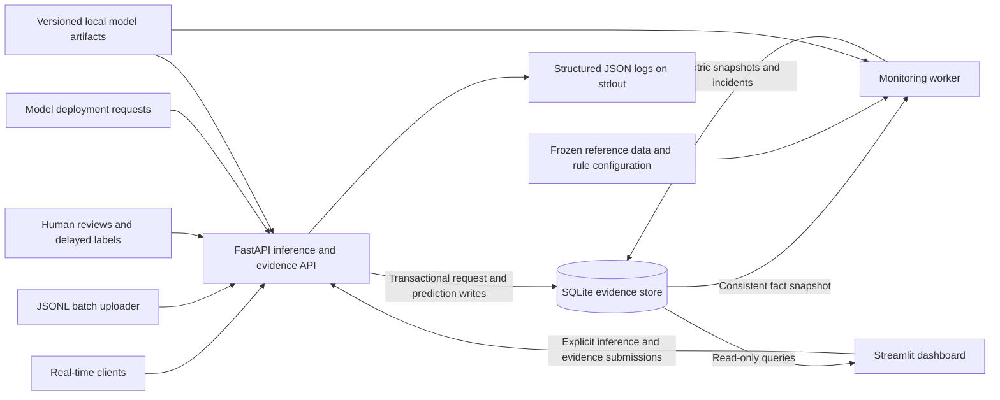
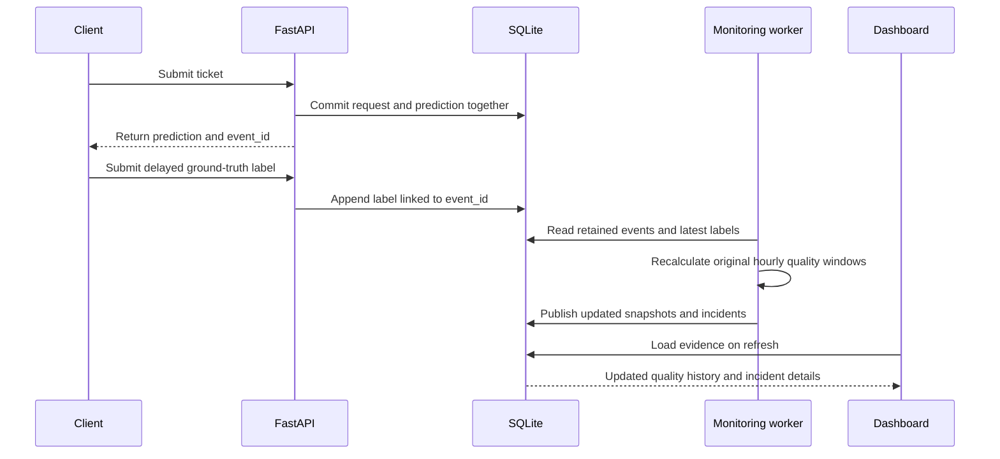

# SignalDesk architecture

SignalDesk monitors a support-ticket classification service. The classifier assigns tickets to
`account`, `billing`, or `technical`; the surrounding system records evidence, evaluates outcomes
when labels arrive, detects operational problems, and supports incident investigation.

This document describes the implemented single-host system. It uses Python, FastAPI, scikit-learn,
SQLite, Streamlit, and Docker Compose. The supplied traffic and failure scenarios are synthetic;
the repository does not establish that a customer-facing production deployment exists.

## System overview

Inference is synchronous: a client receives a prediction in the request that submitted the ticket.
Monitoring is asynchronous: a separate process recomputes metrics and alerts after evidence has
been stored. The dashboard combines persisted monitoring history with summaries calculated from
selected raw events. Its browser view reloads through interaction or explicit refresh; it does not
continuously poll for new data.

## Components and ownership

| Component | Responsibility | Implementation |
|---|---|---|
| Inference and evidence API | Validate inputs, select a model, classify tickets, persist request evidence, accept labels/reviews, and expose history | [signaldesk/api.py](signaldesk/api.py) |
| Model lifecycle | Create synthetic datasets, train classifiers, register checksums, load trusted artifacts, and produce probabilities/anomaly flags | [signaldesk/model.py](signaldesk/model.py) |
| Evidence store | Manage SQLite connections, transactions, initialization, and active deployment selection | [signaldesk/db.py](signaldesk/db.py), [signaldesk/schema.sql](signaldesk/schema.sql) |
| Shared queries | Read predictions, latest labels/reviews, deployments, metric history, and incident samples | [signaldesk/queries.py](signaldesk/queries.py) |
| Metric calculations | Calculate quality, reliability, drift, confidence, feedback, and estimated compute usage without database I/O | [signaldesk/metrics.py](signaldesk/metrics.py) |
| Alert evaluation | Apply thresholds and sample gates; attach likely failure categories | [signaldesk/alerts.py](signaldesk/alerts.py) |
| Monitoring worker | Recompute hourly windows, publish snapshots/incidents, and record pipeline outcomes | [signaldesk/monitor.py](signaldesk/monitor.py) |
| Dashboard | Render seven pages; read the database and submit workbench actions through the API | [dashboard/app.py](dashboard/app.py), [dashboard/data.py](dashboard/data.py) |
| Operations and replay | Bootstrap, train, seed, monitor once, or run the worker loop | [signaldesk/cli.py](signaldesk/cli.py), [signaldesk/seed.py](signaldesk/seed.py) |

The database is the source of truth for recorded evidence and deployment history. Model binaries
live on disk; their manifests and checksums live in the database. Stdout logs provide a separate
operational trace, while dashboard queries use the database rather than parsing those logs.

## Inference and evidence flow

### Real-time requests

1. A client sends `POST /v1/predict`. Request middleware allocates a request ID, starts timing,
   and pins the active model version from deployment history.
2. Pydantic validates the payload. Ticket text must contain 3-5,000 characters after whitespace
   stripping; language and channel must belong to supported enumerations. Extra fields are rejected.
3. The selected TF-IDF and logistic-regression pipeline produces a class, class probabilities,
   confidence, an out-of-vocabulary ratio, and an anomaly flag.
4. The handler stages a prediction event in request-local state. Stored text has email addresses
   and long digit sequences redacted; feature length is measured from the original submitted text.
5. Middleware writes the HTTP request record and all successful prediction events in one SQLite
   transaction. It returns the response after that commit and includes an `X-Request-ID` header.
6. Middleware emits a structured JSON request summary to stdout without ticket text.

Validation failures, authorization failures, and inference exceptions also produce request records
when the evidence store is writable. Failed inference produces no partial prediction records.
If the evidence transaction fails, the API returns HTTP 503 rather than acknowledging an unrecorded
prediction. A failed database cannot persist its own failure; that path is also logged to stdout.

The reported request latency ends before the evidence-store commit. It measures application request
handling, excluding that commit and client/network time. Each prediction also records its own model
inference time. These are distinct measurements.

### Batch requests

`POST /v1/batch` accepts 1-1,000 tickets. It uses the same validation, model, and persistence path as
real-time inference. One HTTP attempt creates one request record; each successfully classified ticket
creates a separate event linked to that request. The model version is pinned once for the whole batch.

Validation is all-or-nothing, and an inference error prevents partial event publication. Classification
runs synchronously within the request; there is no batch queue or background inference worker.
[scripts/batch.py](scripts/batch.py) streams JSONL files into bounded API requests, so a larger file
can be processed without loading the whole file into memory.

### Delayed labels and human feedback

`POST /v1/labels` records adjudicated ground truth against an existing prediction event.
`POST /v1/feedback` records a review, optional corrected class, and comment. These are independent
streams: a review does not silently become ground truth for accuracy calculations.

Both endpoints use an `external_id` for idempotency. Retrying the same evidence returns the existing
record; reusing its ID for different evidence returns HTTP 409. A ground-truth revision uses a new
external ID. Selection of the latest label or review orders by `(received_at, id)` descending.
The ingestion transaction serializes the duplicate check and insert with `BEGIN IMMEDIATE`.

## Storage model and consistency

The schema is defined in [signaldesk/schema.sql](signaldesk/schema.sql).

| Table or view | Stored evidence and relationship |
|---|---|
| `models` | Model version, dataset version, artifact/configuration hashes, prompt applicability, and training metadata |
| `deployments` | Append-only selections of a registered model, with timestamp and reason |
| `requests` | One inference HTTP attempt: model, route, mode, status, latency, item counts, error category, and live/seed source |
| `events` | One successful ticket prediction, linked to its request and model; includes redacted input, features, probabilities, and inference time |
| `labels` | Ground-truth history linked to events, with unique ingestion IDs |
| `feedback` | Independent review history linked to events, with unique ingestion IDs |
| `labeled_events` | View joining each prediction to at most its latest ground-truth label |
| `metric_snapshots` | JSON metrics keyed by UTC window start and model scope; includes computation time and effective threshold hash |
| `incidents` | Deterministic alert identities, time bounds, model scope, evidence, likely cause, and lifecycle state |
| `pipeline_runs` | Job outcomes, timestamps, processed-row counts, and failure details |
| `schema_version` | Current schema initialization version |

SQLite uses write-ahead logging (WAL), foreign keys, time/model indexes, and a 30-second busy timeout.
Read-only connections protect monitoring and dashboard query paths from accidental writes.
The monitoring calculation reads input facts in a consistent database snapshot, then releases that
read transaction before aggregation. Snapshot upserts, incident updates, and the successful pipeline
record are committed together in a later writer transaction. Expensive calculations do not hold a
writer lock.

API reads and monitoring publication are separate transactions. The dashboard can show newer raw
predictions than its last persisted monitoring snapshot; computation timestamps expose this lag.
There is no distributed transaction spanning the database, model filesystem, and stdout log stream.

## Model versions and reproducible experiments

The classifier converts word unigrams/bigrams into TF-IDF features, then applies logistic regression.
`router-v1` is the healthy artifact. `router-v2-bad` intentionally swaps account and billing training
labels to demonstrate a confident model regression. The current loader explicitly supports those
versions and caches loaded artifacts in process memory.

Training registers dataset, configuration, and artifact SHA-256 hashes. A model artifact is checked
against its registered checksum before its first uncached load. Dataset generation rejects changed
content under an existing dataset filename; changing the dataset requires a new version. Registered
model versions are intended to remain immutable, including their on-disk artifacts.

`POST /v1/deployments` checks that a version is registered and loadable, then appends a deployment
record. New requests select the latest applicable deployment by timestamp and ID. Rolling back means
appending a deployment of the prior version, preserving the intervening history. There is no separate
remote model registry, canary router, or automatic retraining loop.

Reproducibility inputs are versioned in Git:

- [tickets-v1.json](data/datasets/tickets-v1.json): 144 synthetic training examples.
- [reference-v1.json](data/datasets/reference-v1.json): 36 frozen reference examples.
- [experiment.json](config/experiment.json): seed, classifier settings, dataset versions, and replay intervals.
- [alerts.json](config/alerts.json) and [baseline.json](config/baseline.json): alert thresholds and operational assumptions.
- [uv.lock](uv.lock): pinned Python dependencies.

There is no LLM or prompt-driven classification step. Model metadata records
`prompt_version=not-applicable`. The training and reference data share templates, so reference
quality is demonstration evidence rather than an independent generalization benchmark.

## Monitoring, metrics, and alerts

The worker runs one monitoring pass, then sleeps for `MONITOR_INTERVAL_SECONDS` (60 by default).
The effective interval is processing time plus the configured sleep, rather than an exact wall-clock
schedule. A one-shot pass is available through `python -m signaldesk.cli monitor`.

Each pass recomputes retained hourly UTC windows, including a possibly partial current hour, for
aggregate scope `__all__` and each model version present in that hour. Recomputing history lets late
or corrected labels revise the original prediction window instead of attributing quality changes
to the label-arrival time. The healthy model scores the frozen reference dataset to provide comparison
distributions and reference F1; the latency baseline comes from versioned configuration.

| Signal | Inputs and interpretation |
|---|---|
| Volume, throughput, errors, p50/p95/p99 latency | HTTP request records; prediction throughput is counted separately from request throughput |
| Accuracy, macro precision/recall/F1, confusion matrix | Predictions with their latest available adjudicated labels; unlabeled quality remains null |
| Label coverage and delay | Labeled-event fraction and elapsed time between prediction and label receipt |
| Confidence and anomalies | Model probabilities, original text length, and out-of-vocabulary n-grams; confidence is not calibrated correctness |
| Input and output drift | Smoothed PSI and KL over language, channel, text length, and predicted-class distributions |
| Reviews and corrections | Latest reviews per event, separate from ground truth |
| Freshness and pipeline health | Time since the last successful prediction, plus recorded monitoring/job outcomes |
| Estimated compute cost | Sum of inference wall time multiplied by a configured hourly rate; excludes idle time and is not a bill |
| LLM-specific metrics | Explicitly null/not applicable for tokens, LLM cost, citations, hallucinations, and safety violations |

Language and channel are client-supplied metadata, not classifications inferred from text. Drift and
anomaly measures are diagnostic heuristics. The current anomaly flag is set when the OOV n-gram
ratio exceeds 0.7 or original text length exceeds 800 characters.

Rules cover latency, errors, quality degradation, input drift, confidence, freshness, and monitoring
failures. Minimum request/label counts gate statistical rules. Predicted-class drift is displayed but
does not independently trigger an input-drift alert. Rules reload each pass from `ALERT_CONFIG`,
which defaults to `config/alerts.json`; snapshots record the effective configuration hash.
See [monitoring definitions](docs/monitoring.md) for formulas, defaults, and denominators.

Incident IDs derive from window start, model scope, and category, so repeated passes update the same
record. A current-hour breach is open; completed historical windows are resolved while retaining
evidence. Resolution expresses window lifecycle, not human acknowledgement or proof of remediation.
Freshness incidents resolve after recent successful predictions; monitoring-pipeline incidents resolve
after a successful pass. A caught monitor exception records a failed pipeline run and critical incident
when storage remains available; the worker logs it and retries on its next loop.

The incident view joins affected versions, request failures, redacted inputs, predictions, and latest
labels. Drilldown returns up to 30 prediction samples prioritized by wrong labeled results, anomalies,
and low confidence, plus up to 30 requests prioritized by errors and latency. The dashboard coalesces
adjacent same-category/model windows for display. Likely causes are rule-based hypotheses.
Alerts are stored in SQLite and exposed through the API and dashboard; external paging is not wired.

## Dashboard read and write boundaries

The seven Streamlit pages cover overview, model quality, drift, latency/reliability, cost/usage,
incidents, and live inference. Shared filters select time range and model version; timestamps use UTC.

Monitoring pages use read-only database queries. Their selected-period cards are recalculated from
raw events, rather than averaging hourly F1 values or percentiles. Charts also consume persisted
hourly snapshots. Live inference and review/label actions call FastAPI using `API_URL` and the configured
API key. The dashboard does not write directly into evidence tables.

## Local runtime and deployment

[compose.yaml](compose.yaml) runs four services from the same [Docker image](Dockerfile):

| Service | Startup role and dependencies |
|---|---|
| `init` | One-shot bootstrap/training; seeds the demo unless `SEED_DEMO=false` |
| `api` | One Uvicorn worker on port 8000; waits for successful initialization |
| `monitor` | Independent monitoring loop; waits for healthy API readiness |
| `dashboard` | Streamlit on port 8501; waits for healthy API readiness |

Named volumes `evidence` and `models` persist the SQLite store and model artifacts. The dashboard
mounts both read-only and reaches the API at `http://api:8000` inside Compose. Published API/dashboard
ports bind to host loopback. Containers run as a non-root application user.

`/healthz` reports process liveness. `/readyz` checks the active deployment and loads its model.
Health probes and management reads are excluded from inference-volume metrics. An optional `API_KEY`
protects application routes using `X-API-Key`; health probes remain available. There is no per-user
identity or role model, and the dashboard itself does not provide user authentication. Redaction is
limited to email-like strings and long numbers, so stored samples may still contain sensitive text.

Native Python deployment uses three processes for API, worker, and dashboard after initialization.
Configuration is supplied through environment variables; native processes do not automatically load
`.env`. See [operations](docs/operations.md) for paths, access boundaries, backups, and deployment setup.

## Delivery and verification

[GitHub Actions](.github/workflows/ci-cd.yml) defines this delivery sequence:

1. **Verify:** install locked dependencies, lint/format-check, run tests, bootstrap synthetic evidence,
   and run browser/API smoke checks. An EXIT trap stops and reaps both test servers before uv cache
   pruning, on both successful and failed smoke-test exits.
2. **Image:** build the Docker image and exercise bootstrap plus the Compose API/monitor/dashboard
   stack. Non-PR runs publish a commit-SHA-tagged image to GitHub Container Registry.
3. **Deploy:** when `DEPLOY_ENABLED=true`, a provisioned private Linux runner pulls the image and
   starts the stack through the named `production` environment. The job requires
   `PRODUCTION_API_KEY`, sets `SEED_DEMO=false`, and checks service readiness.

This describes the configured pipeline; it does not imply that a production deployment is enabled.
[tests/](tests/) covers metrics, drift, rule gates, inference/batch behavior, evidence durability,
label revisions, monitoring recovery, and dashboard queries. [scripts/browser_smoke.py](scripts/browser_smoke.py)
checks all dashboard pages, live inference/review, mobile layout, and HTTP inference-to-label-to-metrics flow.

## Demonstration and scaling boundaries

Bootstrap trains/registers artifacts and replays 72 hours of synthetic evidence. The default replay
contains model degradation, new-language/input drift, and elevated latency/errors, plus delayed labels,
reviews, deployment history, and a failed historical label-import record. Predictions are generated by
the classifier; historical latency and HTTP failures are injected values rather than live load-test
measurements. Bootstrap is idempotent; a fixed timezone-aware anchor and fresh storage paths support
repeatable experiments. See [incident reports](docs/incidents.md) for the seeded investigations.

The current design favors inspectable evidence and reproducibility on one host. Larger deployments
would need deliberate changes rather than simply adding API replicas:

- Replace SQLite/shared local volumes with a storage design suited to multiple hosts, such as PostgreSQL
  and a shared artifact store. PostgreSQL is not included in this repository.
- Track changed windows instead of recomputing all retained history, and bound incident sample queries.
- Add queued execution if batches must run independently of an HTTP request.
- Add an external watchdog and notification delivery; a stopped worker cannot report its own absence.
- Define retention, backup/recovery, authenticated dashboard access, and broader data minimization for
  real customer traffic. Current code does not automatically delete old evidence.

## Related documentation

- [README and setup](README.md)
- [Database schema](docs/schema.md)
- [Monitoring and alerting](docs/monitoring.md)
- [Operations and deployment](docs/operations.md)
- [Seeded incident reports](docs/incidents.md)
- [Recorded verification evidence](docs/verification.md)
