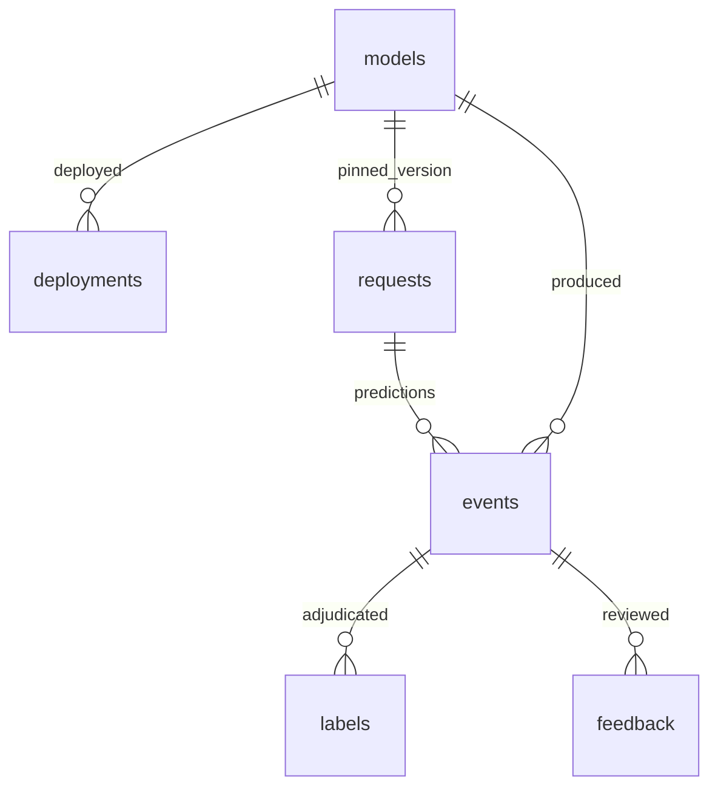

# Evidence schema

The executable schema is [signaldesk/schema.sql](../signaldesk/schema.sql), version 1. Initialization
is additive and idempotent. SQLite foreign keys are enabled on every connection. New schema revisions
must use explicit migrations; `CREATE TABLE IF NOT EXISTS` does not migrate existing columns.

| Table / view | Key | Purpose |
|---|---|---|
| `models` | version | Artifact/config hashes, dataset version, prompt version, training metadata |
| `deployments` | integer ID | Append-only release history and reason; latest deployment at request time is active |
| `requests` | UUID / deterministic seed ID | HTTP time, route, status, mode, duration, item counts, failure category |
| `events` | UUID / deterministic seed ID | Original feature length, redacted input, language/channel, probabilities, anomaly and model version |
| `labels` | integer ID, unique external_id | Append-only ground-truth revisions and arrival timestamps |
| `feedback` | integer ID, unique external_id | Independent reviews, optional corrected class and redacted comment |
| `labeled_events` | view | Every prediction left-joined to its latest label by arrival time and ID |
| `metric_snapshots` | window_start + model_version | Atomic hourly aggregation, computation time and effective threshold hash |
| `incidents` | deterministic window/model/category hash | Breach evidence, window, severity, heuristic cause and current lifecycle state |
| `pipeline_runs` | integer ID | Job successes/failures, processing counts and diagnostic error |
| `schema_version` | version | Installed schema marker |

`__all__` is the aggregate snapshot/incident scope. Per-model scopes are stored independently.
Do not sum aggregate and per-model rows. Snapshot and incident `model_version` are logical scopes,
not foreign keys: they may contain `__all__`. Sample events retain their real version.

All timestamps are UTC ISO 8601 with fixed microsecond precision and an explicit offset. Windows
are half-open `[start,end)`. Labels are joined to the prediction's time window, never to their
arrival window. Feedback coverage likewise refers to the original prediction cohort.

SQLite indexes cover request/event time plus model, label event plus arrival, feedback event,
deployment time, and incident time. Request/event inserts share a transaction. Label and feedback
ingestion enforce referential integrity and external-ID uniqueness; retries cannot double-count.
Each prediction includes a complete class-probability JSON object.

Read-only dashboard connections use SQLite URI `mode=ro`. The writer uses WAL and a 30-second
busy timeout. Monitoring reads facts inside an explicit snapshot transaction and computes outside
the writer lock. `pipeline_runs` failures are written after the failed monitoring transaction rolls
back. If SQLite itself is unavailable, stdout is the only remaining evidence channel.

Inputs have simple email/long-number redaction before storage, but feature lengths use the original
input. This is **not** comprehensive PII detection. Malformed raw bodies are not retained. Consult
the privacy and retention notes in [operations](operations.md) before using real customer data.
